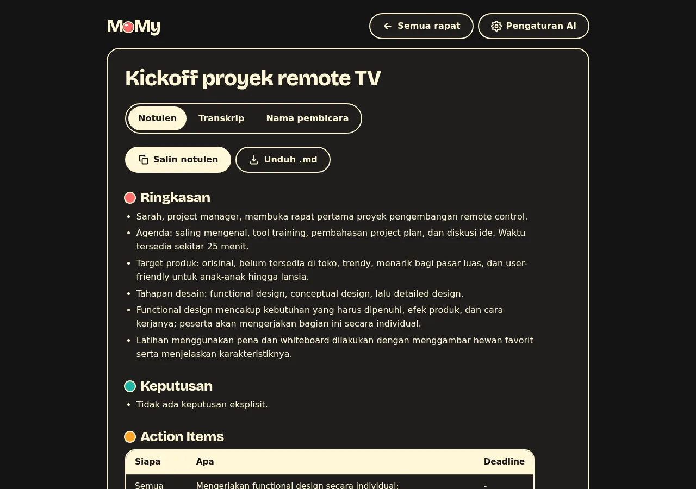
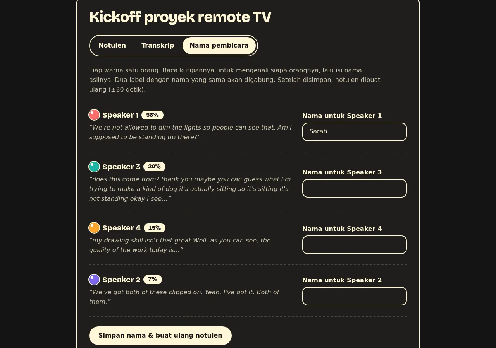
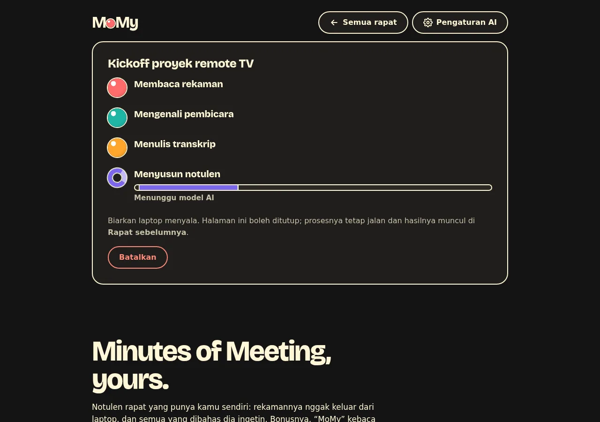

# MoMy

**Minutes of Meeting, yours.** Drop in a meeting recording, get a transcript split by speaker
and the minutes: summary, decisions, action items (who, what, deadline) and open topics.
Everything that touches your audio runs on your own laptop.

Website: **https://momy.stevenmarp.xyz** · The app and the minutes are in Indonesian; the
transcription works for any language Whisper knows.



## Install

Linux and macOS:

```bash
curl -fsSL https://momy.stevenmarp.xyz/install.sh | sh
```

This installs [uv](https://docs.astral.sh/uv/) if needed, then MoMy as a uv tool (with its own
Python 3.12), and a "MoMy" entry in the Linux app menu. Run `momy-ui` to open the app.

Then pick the AI that writes the minutes:

- free and offline: install [Ollama](https://ollama.com) and run `ollama pull gemma3:4b`;
- free and online: get an API key from [Google AI Studio](https://aistudio.google.com/apikey) and
  press **Pakai Gemini (gratis)** under **Pengaturan AI** (uses `gemini-flash-lite-latest` through
  Google's OpenAI-compatible endpoint; on the free tier Google may use the text to improve its
  products);
- or any OpenAI-compatible API: fill in the address, model and API key under **Pengaturan AI**
  in the app.

Needs about 8 GB of RAM and 3 GB of disk for the speech and speaker models, downloaded once on
first use. No GPU needed. Tested on Ubuntu; macOS should work with the same installer but has
not been tried on a real Mac. Windows is untested: `uv tool install git+https://github.com/stevenmarp/momy`
then `momy-ui` is the way to try it.

From a clone instead:

```bash
git clone https://github.com/stevenmarp/momy && cd momy
python3 -m venv .venv && .venv/bin/pip install .
.venv/bin/momy-ui
```

## Use

`momy-ui` opens `http://127.0.0.1:8765` in the browser:

1. drop a recording (mp4, m4a, mp3, wav, webm, ogg, straight from Zoom, Google Meet or a phone),
   optionally with the number of speakers;
2. follow the four steps, with a time estimate, or close the tab, the work goes on;
3. read the minutes, copy them, download them, read the transcript, and on **Nama pembicara**
   rename `Speaker 3` to a real name: the minutes are rewritten with the names in about 30 seconds.

Meetings are stored in `~/MoMy` (`MOMY_DIR` to change it). The app only listens on 127.0.0.1.

| Speakers, each with a colour | Progress |
| --- | --- |
|  |  |

Command line, same pipeline:

```bash
momy meeting.mp4                    # writes meeting.transcript.md and meeting.summary.md next to it
momy meeting.mp4 --speakers 4       # if you know how many people spoke
momy meeting.transcript.md          # rewrite the minutes only, e.g. after renaming speakers
momy meeting.mp4 --language en      # spoken language (default id; auto works too)
```

| Option | Default | What |
| --- | --- | --- |
| `-s`, `--speakers` | auto | number of speakers, if known |
| `--threshold` | `0.9` | auto speaker split: raise it if one person shows up as two, lower it if two get merged |
| `--whisper` | `large-v3-turbo` | Whisper model; `small` is about 2x faster and less accurate |
| `--language` | `id` | spoken language, or `auto` |
| `--model`, `--base-url` | from Pengaturan AI, else `gemma3:4b` on local Ollama | the LLM, any OpenAI-compatible endpoint |
| `--chunk-chars` | 6000 local, 120000 remote | transcript characters per LLM call |
| `--max-tokens` | 1500 local, 16000 remote | answer cap per call (reasoning models need room) |
| `-o`, `--output-dir` | next to the input | where to write the files |
| `--no-summary` | | only write the transcript |

The LLM settings live in `~/.config/momy/config.json` (mode 600), written by the app.
`MOMY_BASE_URL`, `MOMY_MODEL` and `MOMY_API_KEY` override them; `MOMY_CACHE` moves the
downloaded models (default `~/.cache/momy`). The minutes template is `SUMMARY_PROMPT` in
`momy/cli.py`.

## Privacy

- The recording never leaves the laptop: speaker separation and transcription run locally.
- With Ollama, the minutes are written locally too and nothing goes out at all.
- With a remote API, only the transcript text is sent, to that API. The app says so in its
  footer, naming the model and the address.
- The API key is stored in a file only you can read and is never sent back to the page.

## How it works

1. The recording is decoded to 16 kHz mono.
2. Speaker diarization with [sherpa-onnx](https://github.com/k2-fsa/sherpa-onnx): pyannote
   segmentation 3.0 and NeMo TitaNet speaker embeddings, ONNX on CPU, no PyTorch.
   Speakers with only a few seconds of speech in total are merged into the speaker talking next
   to them; with `--speakers N`, the N speakers who talk most are kept.
3. Speech recognition with [faster-whisper](https://github.com/SYSTRAN/faster-whisper), int8 on
   CPU, voice activity filter, word timestamps.
4. Words are cut into sentences (punctuation or a pause over one second); each sentence gets the
   speaker whose turns cover most of it.
5. The LLM writes the minutes. A long meeting is summarized in parts and the notes are merged,
   so a small local model with an 8k context still handles a two-hour meeting.

## Speed and accuracy

Measured on a 15 W laptop CPU (Intel i3-1215U, 8 GB RAM, no GPU):

| Step | 10 min meeting | 69 min meeting |
| --- | --- | --- |
| Speakers + transcript | 5.5 min | 46 min |
| Minutes, remote model | | 32 s |
| Minutes, `gemma3:4b` local | 6 min | did not finish: 8 GB RAM was full with a browser and editor open |

Speaker error rate (DER, no collar, overlap counted) on AMI meeting ES2004a, 4 speakers,
17 minutes: **24.0%** automatic, **22.5%** with `--speakers 4`. For scale, pyannote 3.1
(PyTorch) lists 18.8% over the whole AMI test set. Most of the remaining error is people talking
over each other.

LLMs tried for local minutes: `gemma3:4b` filled the template correctly, `qwen2.5:3b` ignored
it, `qwen3:4b` thought for minutes per part on this CPU. On 8 GB of RAM, a text-only copy of
gemma3 saves 850 MB:

```bash
ollama show --modelfile gemma3:4b | awk '/^FROM/ && seen++ {next} 1' > Modelfile
ollama create gemma3-text:4b -f Modelfile
OLLAMA_FLASH_ATTENTION=1 OLLAMA_KV_CACHE_TYPE=q8_0 ollama serve
```

## Tests

```bash
python test_momy.py
```

## License

MIT, see [LICENSE](LICENSE). The bundled font, Bricolage Grotesque, is under the SIL Open Font
License ([momy/OFL-BricolageGrotesque.txt](momy/OFL-BricolageGrotesque.txt)). The speech and
speaker models are downloaded from their upstream projects and keep their own licenses. The
screenshots show MoMy's real output on meeting ES2004a of the
[AMI Meeting Corpus](https://groups.inf.ed.ac.uk/ami/corpus/) (CC BY 4.0).
